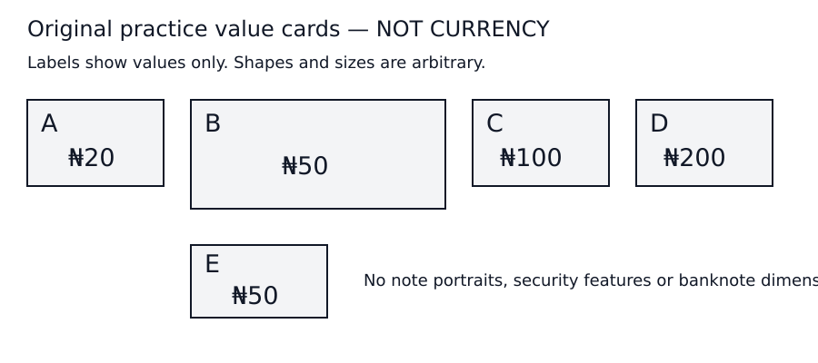

# Original practice value cards for batch 344

The simple boxes and labels are original classroom artwork, not banknote
reproductions or authentic currency. B is deliberately larger than E although
both carry the same value. Show readable labels for003/004; the task assesses
value-label identification, not an unlabelled or genuine-note recognition skill.
The alt text is descriptive; an equivalent accessible assessment needs independent
review. Actual classroom/app/print delivery has not occurred.

Selected denomination facts: CBN Legal Tender page,
https://www.cbn.gov.ng/currency/legaltender.html, checked20November2026.
Artwork/prompt/rubrics are original; no CBN image or logo has been reproduced.
